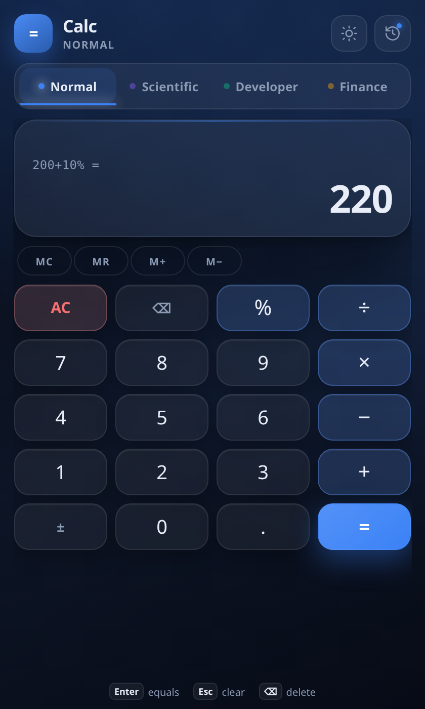
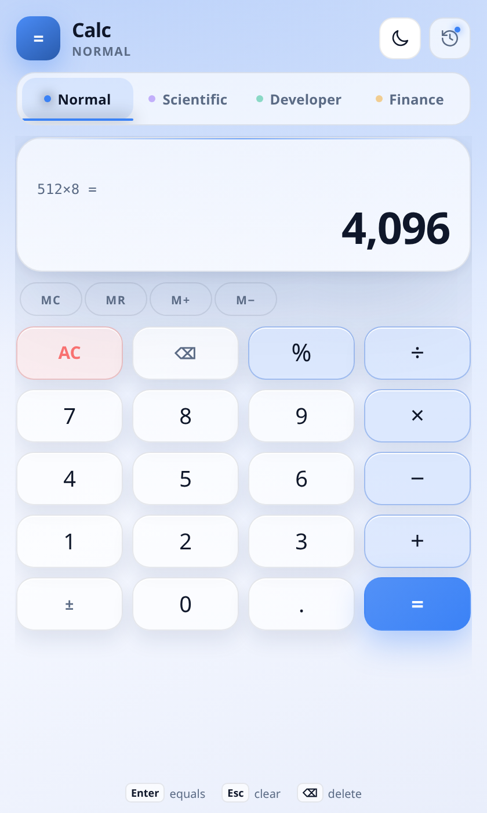
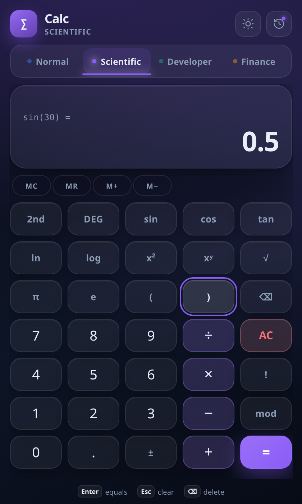
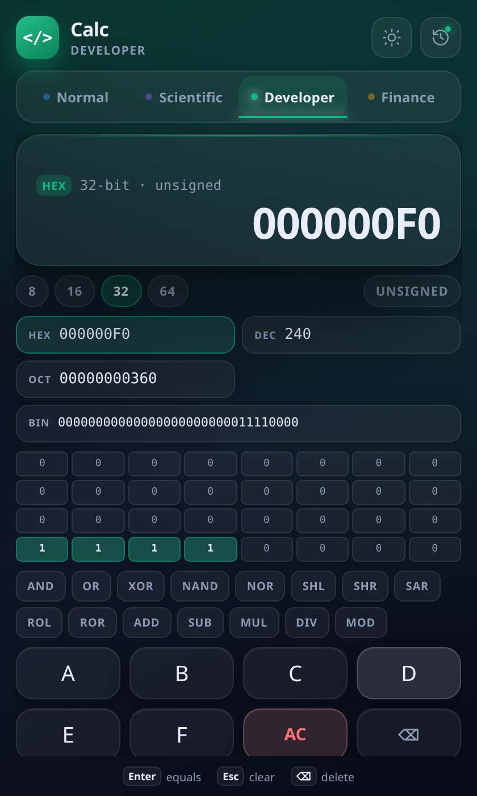
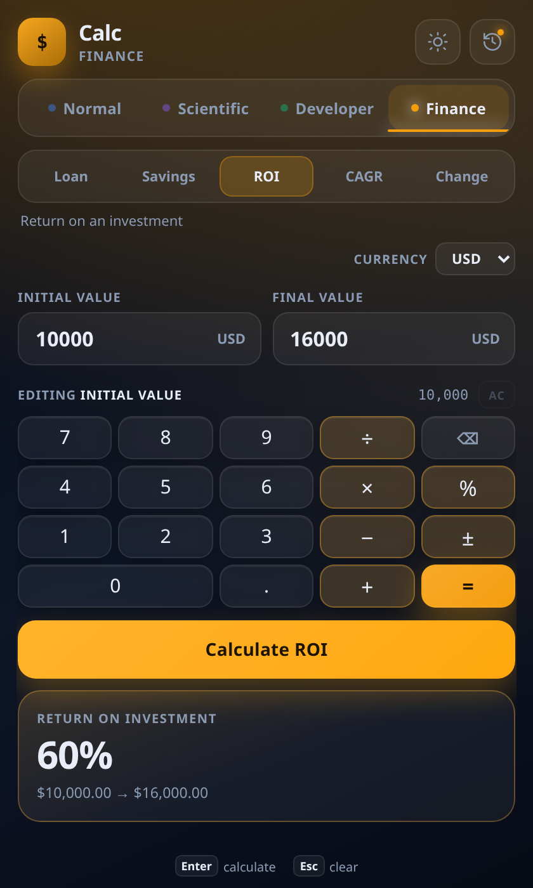
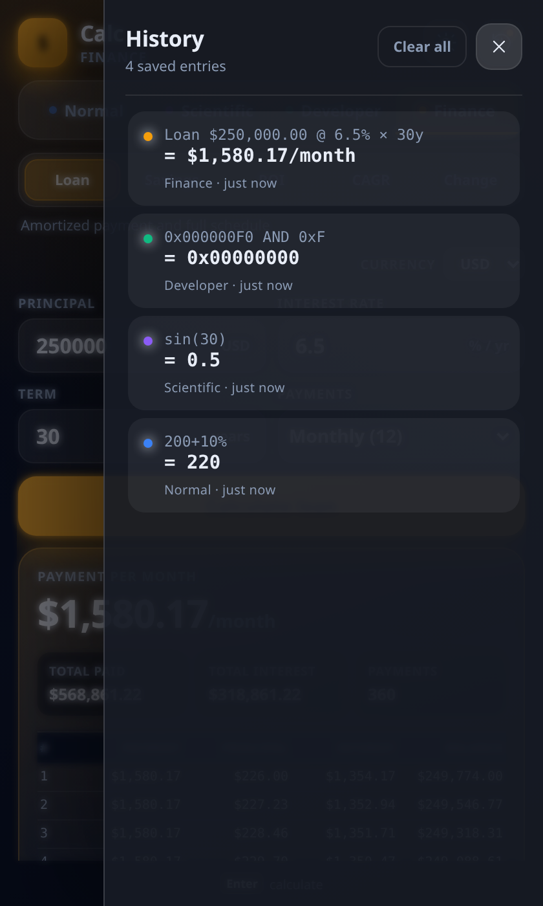

# Calc

[](https://github.com/frndly-bot/calc-app/actions/workflows/ci.yml)
[](LICENSE)

A native desktop calculator with four modes — **Normal**, **Scientific**, **Developer** and **Finance** — built with Go, Wails v3 and SvelteKit (Svelte 5). Dark glass by default, with a light theme, per-mode accent colours and a full keyboard workflow.

<table align="center">
  <tr>
    <th align="center">Dark theme</th>
    <th align="center">Light theme</th>
  </tr>
  <tr>
    <td align="center"></td>
    <td align="center"></td>
  </tr>
</table>

## Download

Grab the latest build from [Releases](https://github.com/frndly-bot/calc-app/releases/latest). Pushing a `v*` tag builds and publishes Linux packages, a macOS (Apple Silicon) dmg and an Android APK; asset names include the version (for example `calc-app_1.2.3_amd64.deb`) and every release includes a `SHA256SUMS` file.

| Package | Best for | Install |
| --- | --- | --- |
| `calc-app*.AppImage` | Any Linux, no install needed | `chmod +x ./calc-app*.AppImage && ./calc-app*.AppImage` |
| `calc-app*.deb` | Debian, Ubuntu, Mint | `sudo apt install ./calc-app*.deb` |
| `calc-app*.rpm` | Fedora, RHEL, openSUSE | `sudo dnf install ./calc-app*.rpm` |
| `calc-app*.pkg.tar.zst` | Arch Linux | `sudo pacman -U calc-app*.pkg.tar.zst` |
| `calc-app` or `calc-app_*_linux_amd64` | Portable raw Linux binary | `chmod +x <file> && ./<file>` |
| `Calc*-arm64.dmg` | macOS 12+ on Apple Silicon | Open the dmg and drag **Calc** to Applications |
| `calc-app*_android_arm64.apk` | Android 5.0+ (arm64 devices) | Side-load the APK and allow installs from this source |

The .deb and .rpm packages pull in GTK4 and WebKitGTK 6.0 automatically. The AppImage and raw binary use the system webview, so install `libgtk-4-1` and `libwebkitgtk-6.0-4` first on minimal distributions.

The macOS build is ad-hoc signed, so the first launch may need a right-click → **Open** (or `xattr -d com.apple.quarantine /Applications/Calc.app`). The Android APK is signed with the project's debug keystore for side-loading; Google Play uploads need a release keystore (see [docs/packaging.md](docs/packaging.md)).

Windows and Intel Mac builds are not published yet; see [docs/packaging.md](docs/packaging.md) to build them locally.

When the release includes checksums, verify a download with:

```bash
sha256sum --check SHA256SUMS
```

## Features

- **Normal** — instant arithmetic in TypeScript with `%`, `±`, parentheses, memory keys and an expression preview.
- **Scientific** — trig/log/power/factorial engine in Go, DEG/RAD/GRAD units and a 2nd-function layer.
- **Developer** — 8/16/32/64-bit words, signed/unsigned reinterpretation, simultaneous HEX/DEC/OCT/BIN readouts, bitwise operations and a clickable bit grid.
- **Finance** — loan payment + amortization schedule, savings future value, ROI, CAGR and percentage change with currency formatting.
- **History** — every confirmed result is persisted locally, searchable at a glance, and deletable individually or all at once.
- **Persistence** — theme, last mode, angle unit, word size, sign mode and currency survive restarts.
- **Keyboard-first** — digits, operators, Enter, Backspace and Escape work in every mode.
- **Reduced motion** — animations are disabled automatically under `prefers-reduced-motion`.

<table align="center">
  <tr>
    <th align="center">Scientific</th>
    <th align="center">Developer</th>
  </tr>
  <tr>
    <td align="center"></td>
    <td align="center"></td>
  </tr>
</table>

<table align="center">
  <tr>
    <th align="center">Finance</th>
    <th align="center">History</th>
  </tr>
  <tr>
    <td align="center"></td>
    <td align="center"></td>
  </tr>
</table>

## Stack

| Layer | Technology |
| --- | --- |
| Desktop shell | Wails v3 (`v3.0.0-beta.34`) |
| Backend | Go 1.27, pure calculation packages + Wails services |
| Frontend | SvelteKit 3, Svelte 5 runes, TypeScript, Vite 8 |
| Styling | Hand-written CSS, glass surfaces, per-mode CSS variables |
| Tests | `go test`, Vitest, Playwright |
| Packaging | Task, Wails v3 platform taskfiles, NSIS, AppImage/deb, .app/dmg, Gradle/APK |

## Quick start

Prerequisites: Go 1.27+, Node 24+, [pnpm](https://pnpm.io/), [Task](https://taskfile.dev/), the [Wails v3 CLI](https://v3.wails.io/), and the platform webview development packages (see [docs/development.md](docs/development.md)).

```bash
git clone https://github.com/frndly-bot/calc-app.git
cd calc-app
pnpm --dir frontend install

task dev          # Wails hot-reload loop
# or
task build        # native binary in bin/
task run
```

### Browser preview

The same frontend and backend can run headlessly over HTTP — useful for CI, screenshots and UI checks without a desktop session:

```bash
task serve        # builds frontend + server binary, serves http://localhost:34115
```

### Tests and checks

```bash
task test         # Go tests + Vitest
task test:e2e     # Playwright against the headless server
task check        # go vet + svelte-check
task lint         # gofmt check + all of the above
```

The first E2E run needs a browser: `pnpm --dir frontend exec playwright install chromium`.

## Task reference

| Task | Description |
| --- | --- |
| `task` | List all tasks |
| `task dev` | Wails hot-reload development loop |
| `task build` | Native build for the current OS |
| `task run` | Run the native build |
| `task package` | AppImage + deb (Linux), NSIS (Windows), .app + dmg (macOS) |
| `task serve` | Headless HTTP preview on port 34115 |
| `task test` | Go and frontend unit tests |
| `task test:e2e` | Playwright end-to-end tests |
| `task check` | `go vet` and `svelte-check` |
| `task generate:icons` | Regenerate `.ico`/`.icns` from `build/appicon.png` |
| `task generate:bindings` | Optional Wails TS binding generation (see docs) |
| `task clean` | Remove build output |

## Project layout

```
.
├── main.go                 # Wails bootstrap, embedded frontend, service wiring
├── backend/
│   ├── calc/               # pure Go engines: parser, scientific, developer, finance
│   ├── services/           # CalcService, HistoryService, SettingsService
│   └── config/             # config-dir resolution and atomic JSON I/O
├── frontend/
│   └── src/
│       ├── lib/modes/      # Normal, Scientific, Developer, Finance views
│       ├── lib/components/ # Display, keys, keypad, history, toasts
│       ├── lib/stores/     # settings, mode, memory, history, toast (runes)
│       ├── lib/eval/       # TypeScript evaluator used by Normal mode
│       └── lib/bindings/   # typed wrappers over Wails runtime calls
├── build/                  # icons, platform taskfiles, packaging configs, Android project
├── docs/                   # architecture, modes, development, packaging
└── .github/workflows/ci.yml
```

## Data storage

Application state lives in the OS config directory:

- Linux: `$XDG_CONFIG_HOME/calc-app/` (defaults to `~/.config/calc-app/`)
- macOS: `~/Library/Application Support/calc-app/`
- Windows: `%AppData%\calc-app\`
- Android: the app's private files directory (`getFilesDir()/calc-app/`)

`settings.json` holds preferences; `history.json` keeps the newest 200 calculations. Writes are atomic (temp file + rename).

## Documentation

- [Architecture](docs/architecture.md) — how the Go engines, Wails services and Svelte stores fit together.
- [Modes](docs/modes.md) — behaviour, grammar and keyboard reference for each mode.
- [Development](docs/development.md) — setup, dev loop, testing and troubleshooting.
- [Packaging](docs/packaging.md) — per-OS builds, installers and release checklist.

## License

[MIT](LICENSE)
